<p align="center"></p>

<p align="center"><b>English</b> · <a href="README.zh-CN.md">中文</a></p>

Lean back and drive your coding agent from the couch. **padpilot** turns a PS5 DualSense into a remote for **Claude Code**, **OpenAI Codex CLI** and the **Claude desktop app**:

- **The controller shows what the agent is doing.** The lightbar breathes blue while it thinks, blinks orange when it needs your approval and turns green when it is done. Rumble, the adaptive triggers and the controller's own speaker do the same.
- **The buttons drive it.** ✕ approves, ○ interrupts, △ says "continue", R3 retries your last message, and holding △ opens a wheel of 8 ready-made prompts. One layout works in all three apps.
- **A built-in tutorial teaches the buttons** step by step, with the real controller. While the page is open, nothing you press reaches the agent.

<p align="center"></p>

```
 Claude Code / Codex ──hooks──▶ padpilot daemon ──HID──▶ DualSense (light / rumble / triggers / speaker)
        ▲                          │   ▲
        └──── keystrokes ◀─────────┘   └──── buttons / sticks / touchpad
     (PTY wrapper, or the Claude desktop app on macOS)
```

## Install

You need a DualSense (USB or Bluetooth), Python 3.8 or newer, and macOS. Linux should work for the terminal parts but has not been tested; controlling the Claude desktop app is macOS only.

```bash
git clone https://github.com/XixianWasTaken/padpilot.git
cd padpilot
./bin/padpilot setup                                   # installs hidapi into ~/.padpilot/venv
ln -sf "$PWD/bin/padpilot" ~/.local/bin/padpilot        # put padpilot on your PATH

claude plugin marketplace add "$PWD"                  # the Claude Code plugin (hooks + slash commands)
claude plugin install padpilot@padpilot

padpilot install-codex      # optional: Codex hooks (backs up ~/.codex/hooks.json first), then run /hooks in Codex once
padpilot doctor             # checks hidapi, the controller and the daemon
padpilot demo               # rainbow light + rumble
```

Then learn the buttons: type `/padpilot:tutorial` in Claude Code, or run `padpilot tutorial`.

## Use it

```bash
alias cc='padpilot run claude'   # Claude Code, with the controller typing into it
alias cx='padpilot run codex'    # Codex CLI
```

`padpilot run` wraps the agent in a terminal that looks and works exactly as before; the controller's buttons become keystrokes. Without the wrapper (an IDE, or the agent started directly) the lights and rumble still work, and permission requests wait up to 45 seconds for ✕ (approve) or ○ (deny) before the normal dialog appears.

**Claude desktop app (macOS).** When no `padpilot run` session is open, buttons are sent as real key presses to the Claude app, but only while it is the frontmost window. The first time, run `padpilot desktop` and allow Accessibility access for the daemon's Python.

## What the controller tells you

| Agent state | Lightbar | Rumble |
|---|---|---|
| Idle | soft white, slow breathing | two light taps when a session starts |
| Thinking | blue breathing | – |
| Running a tool | fast breathing, coloured by tool (Bash orange, edits magenta, reads cyan, web blue, subagents purple) | a tick per call |
| **Needs approval** | **blinking orange**; R2 gets a click point, pull through = approve | **two strong pulses**, repeated up to 3 times |
| Waiting for your answer | yellow breathing | a nudge |
| Done | **solid green until you press a key**; a long turn plays a rainbow first | success pattern |
| Error | blinking red | long buzz |
| Microphone in use | fast white breathing, mic LED on | tap on / tap off |

The player LEDs show how far the turn has got, or how many reply buttons a next-step card offers. Over USB the controller's speaker also plays a short sound on done, approval and error (macOS).

## Buttons

The same button does the same thing in the desktop app, Claude Code and Codex. Each button is mapped to an *action* (submit, cancel, clear input…), turned into whatever keys that app uses, including your own `~/.claude/keybindings.json`. If an app has no such action, nothing is sent and the light flashes red.

| Button | Does |
|---|---|
| ✕ / R2 pulled through | submit, confirm, approve |
| ○ / L2 pulled through | cancel, interrupt, deny |
| □ | clear the input box |
| △ | type `continue` and send |
| **hold △ + right stick** | **prompt wheel**: 8 preset prompts, filled in when you let go of △ |
| R1 + ✕ / ○ / □ / △ | pick button 1–4 on Claude's next-step card |
| R1 | `/` (slash-command menu) |
| **R3** | **retry**: send your last message again |
| L1 | cycle permission mode |
| L1 + ✕ / ○ / □ / △ | queue a message · stop subagents · undo · external editor |
| D-pad / left stick | arrow keys |
| right stick ↑↓ / touchpad swipe | page up / down |
| right stick ← → | previous / next session |
| Create (hold) | new session |
| Options | show changes / transcript |
| mic | dictation in the Claude app; hold to talk |
| PS | battery level; **hold** to force-interrupt |
| PS + ↑↓ / ←→ / □ / △ / mic | brightness · rumble strength · idle light · speaker sounds · lock the controller |

`padpilot keys` prints the full table, with the exact keys each button sends in each app under your current settings.

## Configure

Put only what you want to change in `~/.padpilot/config.json`; it is merged over the defaults in [padpilot/config.py](padpilot/config.py). Then run `padpilot stop`, and the daemon restarts with it the next time it is needed.

```json
{
  "brightness": 0.6,
  "rumble_scale": 0.5,
  "prompt_wheel": ["continue", "run the tests and fix failures", "explain what you just did", "stop and ask me first",
                   "commit", "write tests for this", "summarise the changes", "keep fixing this bug"],
  "mapping": { "triangle": ["text:continue, then run the tests", "act:submit"] }
}
```

## Commands

```bash
padpilot tutorial          # open the tutorial page (practice mode while it is open)
padpilot status            # controller, battery and sessions as JSON
padpilot keys              # the button layout for your settings
padpilot watch --practice  # print every press without sending anything
padpilot send "write a test"
padpilot doctor
```

Slash commands in Claude Code: `/padpilot:tutorial`, `/padpilot:status`, `/padpilot:demo`, `/padpilot:doctor`, `/padpilot:desktop`.

## Troubleshooting

- Only one program can open the controller. Steam and other controller mappers can keep the daemon from opening it.
- Logs: `~/.padpilot/daemon.log` and `daemon.stderr`.
- The daemon keeps the controller to itself, so macOS never sees the PS button (which would otherwise open Apple's Games app). Set `"share_controller": true` if another app needs to read it too.

The full reference (every light, rumble, sound and edge case) is in the [Chinese README](README.zh-CN.md).

## Development

```bash
python3 -m unittest tests/test_core.py   # protocol, buttons, lights, state machine; no controller needed
python3 tests/drive_wrapper.py           # PTY wrapper with a fake agent (needs the daemon)
python3 tests/drive_claude.py            # end to end with real Claude Code (uses a few tokens)
python3 docs/make_logo.py docs/logo.svg  # regenerate the banner
```

## License

[MIT](LICENSE)
