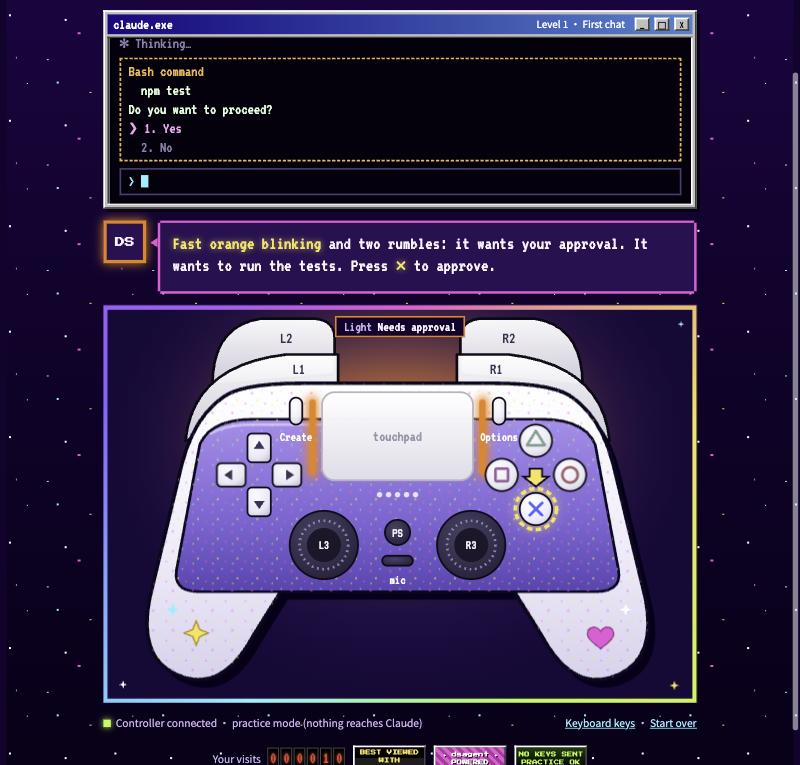

<p align="center"></p>

<p align="center"><b>English</b> · <a href="README.zh-CN.md">中文</a></p>

Lean back and drive your coding agent from the couch. **padpilot** turns a PS5 DualSense into a remote for **Claude Code**, **OpenAI Codex CLI** and the **Claude desktop app**:

- **The controller shows what the agent is doing.** The lightbar breathes blue while it thinks, blinks orange when it needs your approval and turns green when it is done. Rumble, the adaptive triggers and the controller's own speaker do the same.
- **The buttons drive it.** ✕ approves, ○ interrupts, △ says "continue", R3 retries your last message, and holding △ opens a wheel of 8 ready-made prompts. One layout works in all three apps.
- **A built-in tutorial teaches the buttons** step by step, with the real controller. While the page is open, nothing you press reaches the agent.

<p align="center"></p>

```
 Claude Code / Codex ──hooks──▶ padpilot daemon ──HID──▶ DualSense (light / rumble / triggers / speaker)
        ▲                          │   ▲
        └──── keystrokes ◀─────────┘   └──── buttons / sticks / touchpad
     (PTY wrapper, or the Claude desktop app on macOS)
```

## Install

You need a DualSense (USB or Bluetooth), Python 3.8 or newer, and macOS. Linux should work for the terminal parts but has not been tested; controlling the Claude desktop app is macOS only.

```bash
git clone https://github.com/XixianWasTaken/padpilot.git
cd padpilot
./bin/padpilot setup                                   # installs hidapi into ~/.padpilot/venv
ln -sf "$PWD/bin/padpilot" ~/.local/bin/padpilot        # put padpilot on your PATH

claude plugin marketplace add "$PWD"                  # the Claude Code plugin (hooks + slash commands)
claude plugin install padpilot@padpilot

padpilot install-codex      # optional: Codex hooks (backs up ~/.codex/hooks.json first), then run /hooks in Codex once
padpilot doctor             # checks hidapi, the controller and the daemon
padpilot demo               # rainbow light + rumble
```

Then learn the buttons: type `/padpilot:tutorial` in Claude Code, or run `padpilot tutorial`. For the whole reference in one place, run `padpilot manual`.

## Use it

```bash
alias cc='padpilot run claude'   # Claude Code, with the controller typing into it
alias cx='padpilot run codex'    # Codex CLI
```

`padpilot run` wraps the agent in a terminal that looks and works exactly as before; the controller's buttons become keystrokes. Without the wrapper (an IDE, or the agent started directly) the lights and rumble still work, and permission requests wait up to 45 seconds for ✕ (approve) or ○ (deny) before the normal dialog appears. A press in the first 0.6 seconds after a request appears does not answer it, because it was already on its way to something else: the pad buzzes twice, and the next press counts. An agent that a `padpilot run` session starts itself (`claude -p` from its shell tool) is left out; its events are not that session's.

**Claude desktop app (macOS).** When no `padpilot run` session is open, buttons are sent as real key presses to the Claude app, but only while it is the frontmost window. While a `padpilot run` session is open the buttons go to it, with one exception: when the Claude app is in front with a question box open, and the terminal session is not asking or waiting itself, R1 + face button and Submit (✕, R2) answer that box. A question box that is not on screen (it belongs to another session) takes no presses: ✕ is Enter as usual. The first time, run `padpilot desktop` and allow Accessibility access for the daemon's Python.

## What the controller tells you

| Agent state | Lightbar | Rumble |
|---|---|---|
| Idle | soft white, slow breathing | two light taps when a session starts |
| Thinking | blue breathing | – |
| Running a tool | fast breathing, coloured by tool (Bash orange, edits magenta, reads cyan, web blue, subagents purple) | a tick per call |
| **Needs approval** | **blinking orange**; R2 gets a click point, pull through = approve | **two strong pulses**, repeated up to 3 times |
| Waiting for your answer | yellow breathing | a nudge |
| Done | **solid green until you press a key** (for up to 12 hours); a long turn plays a rainbow first | success pattern |
| Error | blinking red | long buzz |
| Microphone in use | fast white breathing, mic LED on | tap on / tap off |

The player LEDs show how far the turn has got, or how many reply buttons a next-step card offers. Over USB the controller's speaker also plays a short sound on done, approval and error (macOS).

## Buttons

The same button does the same thing in the desktop app, Claude Code and Codex. Each button is mapped to an *action* (submit, cancel, clear input…), turned into whatever keys that app uses, including your own `~/.claude/keybindings.json`. If an app has no such action, nothing is sent and the light flashes red.

| Button | Does |
|---|---|
| ✕ / R2 pulled through | submit, confirm, approve |
| ○ / L2 pulled through | cancel, interrupt, deny |
| □ | clear the input box |
| △ | type `continue` and send |
| **hold △ + right stick** | **prompt wheel**: 8 preset prompts, filled in when you let go of △ |
| R1 + ✕ / ○ / □ / △ | pick button 1–4 on Claude's next-step card, or option 1–4 in a question box (✕ submits a multiple-choice one) |
| R1 | `/` (slash-command menu) |
| **R3** | **retry**: send your last message again |
| L1 | cycle permission mode |
| L1 + ✕ / ○ / □ / △ | queue a message · stop subagents · undo · external editor |
| D-pad / left stick | arrow keys |
| right stick ↑↓ / touchpad swipe | page up / down |
| right stick ← → | previous / next session |
| Create (hold) | new session |
| Options | show changes / transcript |
| mic | dictation in the Claude app; hold to talk |
| PS | battery level; **hold** to force-interrupt |
| PS + ↑↓ / ←→ / □ / △ / mic | brightness · rumble strength · idle light · speaker sounds · lock the controller |

`padpilot keys` prints the full table, with the exact keys each button sends in each app under your current settings.

## Configure

Put only what you want to change in `~/.padpilot/config.json`; it is merged over the defaults in [padpilot/config.py](padpilot/config.py). Then run `padpilot stop`, and the daemon restarts with it the next time it is needed. A value of the wrong kind (text where a number belongs, say) keeps its default; `padpilot doctor` lists such values, and keys that are not settings.

```json
{
  "brightness": 0.6,
  "rumble_scale": 0.5,
  "prompt_wheel": ["continue", "run the tests and fix failures", "explain what you just did", "stop and ask me first",
                   "commit", "write tests for this", "summarise the changes", "keep fixing this bug"],
  "mapping": { "triangle": ["text:continue, then run the tests", "act:submit"] }
}
```

## Commands

```bash
padpilot tutorial          # open the tutorial page (practice mode while it is open)
padpilot manual            # open the manual, in Chinese or English
padpilot status            # controller, battery and sessions as JSON
padpilot keys              # the button layout for your settings
padpilot watch --practice  # print every press without sending anything
padpilot send "write a test"
padpilot doctor
```

Slash commands in Claude Code: `/padpilot:tutorial`, `/padpilot:status`, `/padpilot:demo`, `/padpilot:doctor`, `/padpilot:desktop`. Each one may run only its own `padpilot` subcommand without asking.

## What padpilot runs, reads and sends

Everything runs on your own computer. padpilot has no server and no telemetry, and nothing about your sessions leaves the machine. The full list:

- **Hooks.** Claude Code runs `bin/padpilot hook claude` on these events: SessionStart, SessionEnd, UserPromptSubmit, PreToolUse, PermissionRequest, PermissionDenied, PostToolUse, PostToolUseFailure, Notification, Stop, StopFailure, SubagentStop, PreCompact, PostCompact and Elicitation. Each run sends one small message to the padpilot daemon over a local Unix socket (`~/.padpilot/daemon.sock`). The message holds the event name, session id, working folder and tool name. On UserPromptSubmit it also holds your prompt, kept in the daemon's memory for the R3 retry button and never written to disk. When Claude shows a next-step card, it holds the labels of the card's buttons; for a question box, the option labels and whether several may be picked (not the question itself).
- **Permission requests.** Without `padpilot run`, the PermissionRequest hook waits up to 45 seconds (`hook_approval_timeout_s`). It answers allow when you press ✕ and deny when you press ○; otherwise Claude Code shows its normal dialog. A question box's permission request is not held; it is answered in the box. A press within 0.6 seconds (`approval_grace_ms`) after a request appears does not answer it, and neither does Enter on a prompt that has just appeared in a `padpilot run` session. Practice mode does not hold requests. `padpilot press` and `padpilot send` never answer a permission request; only the controller does.
- **The daemon.** The first hook starts a background process that opens the DualSense over USB or Bluetooth (HID). It exits after 4 hours without activity (`idle_shutdown_minutes`), or with `padpilot stop`. When the plugin's code is newer than the code the daemon runs (after an update), the next session start, prompt or permission request replaces the daemon, unless the newer code fails to load; the new one no longer knows the cards and last prompts of the sessions.
- **One download.** The first time the daemon is needed, padpilot creates `~/.padpilot/venv` and installs `hidapi==0.15.0` from PyPI with pip. That is the only thing padpilot downloads.
- **Files it reads.**
  - The end of the current Claude Code session's transcript (the file a hook event names), for one thing only: how many tokens the last request used, which drives the context warning. No message text is used or kept. Your last message and the next-step card come from hook events, not from the transcript.
  - `~/.claude/keybindings.json`, and the dictation shortcut in the Claude app's `claude_desktop_config.json`, so the buttons send the keys you use.
  - `~/.padpilot/config.json`, your settings.
- **Files it writes**, all in `~/.padpilot/`:
  - `config.json`, only when you change a setting with a PS combo;
  - `daemon.log`, with button names, session states and the keys sent (typed text is logged by its length only, never its content);
  - `daemon.stderr`, the socket and the pid file;
  - `sounds/`, macOS system sounds converted for the controller with `afconvert`;
  - the `venv/`.

  `padpilot install-codex` writes `~/.codex/hooks.json`, after backing it up, only when you run it.
- **Keystrokes (macOS).** With Accessibility permission, the daemon posts key presses (Quartz CGEvents) to the Claude desktop app. Before each press it checks with `lsappinfo` that the Claude app is the frontmost app, and sends nothing when another app is in front. The presses are posted to the Claude app's process alone, so they cannot reach another app that comes to the front meanwhile, and a long text stops being typed when that happens. Before typing, sending, clearing or interrupting (Esc), it uses the Accessibility API to move keyboard focus to the message box if something else has it: a button, the sidebar, or another text field such as the browser pane's address bar (an open menu or dialog keeps it). For this it turns on the Claude app's accessibility tree and reads element roles and labels, never their text. Shortcut letters are posted at the position they have on your keyboard layout (Cmd+A on a French keyboard is not Cmd+Q); a short-lived child process reads the layout, at most every three seconds and only for those keys. `padpilot run` types into its own terminal session instead.
- **Microphone.** It asks CoreAudio whether any app is recording, to light the controller's mic LED. It never opens the microphone and never records audio.
- **Sound.** Cues are macOS system sounds played on the controller's own speaker (USB only).
- **Tutorial and manual pages.** Served on `http://127.0.0.1:8737/` and `/manual`, answering only pages from that address. Their fonts come with padpilot (`padpilot/fonts/`, SIL Open Font License), so the pages load nothing from the internet.

## Troubleshooting

- Only one program can open the controller. Steam and other controller mappers can keep the daemon from opening it.
- Logs: `~/.padpilot/daemon.log` (and `daemon.log.1` with what came before; 1 MB each) and `daemon.stderr`.
- The daemon keeps the controller to itself, so macOS never sees the PS button (which would otherwise open Apple's Games app). Set `"share_controller": true` if another app needs to read it too.

The full reference (every light, rumble, sound and edge case) is in the [Chinese README](README.zh-CN.md).

## Development

```bash
python3 -m unittest tests/test_core.py   # protocol, buttons, lights, state machine; no controller needed
python3 tests/drive_wrapper.py           # PTY wrapper with a fake agent (needs the daemon)
python3 tests/drive_claude.py            # end to end with real Claude Code (uses a few tokens)
python3 docs/make_logo.py docs/logo.svg  # regenerate the banner
python3 docs/make_fonts.py FONT_DIR       # rebuild padpilot/fonts after adding Chinese text to a page
```

## License

[MIT](LICENSE)
