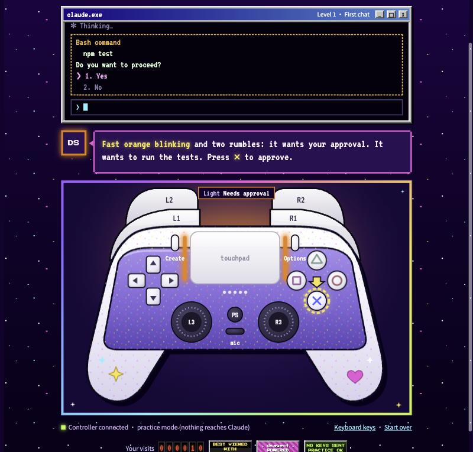

<p align="center"></p>

<p align="center"><a href="README.md">English</a> · <b>中文</b></p>

靠在椅背上，用手柄指挥你的编程 Agent。**padpilot** 把 PS5 DualSense 手柄变成 **Claude Code**、**OpenAI Codex CLI** 和 **Claude 桌面 App** 的无线遥控器：

- **一眼看懂状态**：思考时蓝灯慢呼吸，调用工具时按类型变色，**等审批时橙灯快闪 + 强双震 + R2 扳机段落上膛**，完成时绿灯常亮，出错时红灯闪烁。USB 连接下还能通过手柄内置扬声器播放状态提示音。
- **一套键位通吃**：`✕` / `R2` 批准与发送，`○` / `L2` 取消与打断，`□` 清空输入，`△` 发送 `continue`，`R3` 重发上一条消息，按住 `△` 呼出 8 向快捷语轮盘。三个软件共用同一套键位，并自动适配你的自定义快捷键。
- **内置互动驾校**：运行 `padpilot tutorial`（或在 Claude Code 中输入 `/padpilot:tutorial`）打开复古风交互式教程，一步一键真机实操。教程页面开启期间自动进入练习模式，任何按键都不会误发给 Agent。

<p align="center"></p>

```
 Claude Code / Codex ──Hooks──▶ padpilot daemon ──HID──▶ DualSense（光条 / 震动 / 扳机 / 喇叭）
        ▲                            │   ▲
        └──── 按键注入 ◀──────────────┘   └──── 按键 / 摇杆 / 触摸板
     （PTY 终端包装器，或 macOS Claude 桌面 App）
```

---

## 安装

需要 DualSense 手柄（USB 或蓝牙）、Python ≥ 3.8 以及 macOS（终端模式在 Linux 下也可运行；Claude 桌面 App 控制仅支持 macOS）。

```bash
git clone https://github.com/XixianWasTaken/padpilot.git
cd padpilot

# 1. 初始化运行环境（在 ~/.padpilot/venv 中安装 hidapi）并加入 PATH
./bin/padpilot setup
ln -sf "$PWD/bin/padpilot" ~/.local/bin/padpilot

# 2. 安装 Claude Code 插件（包含 Hooks 与斜杠命令）
claude plugin marketplace add "$PWD"
claude plugin install padpilot@padpilot

# 3. （可选）安装 Codex Hooks（会自动备份 ~/.codex/hooks.json，随后在 Codex 中执行一次 /hooks 信任）
padpilot install-codex

# 4. 自检与体验
padpilot doctor             # 检查 hidapi、手柄连接与守护进程
padpilot demo               # 体验彩虹灯效与震动
padpilot tutorial           # 打开互动新手教程（手柄驾校）
padpilot manual             # 打开双语说明书
```

---

## 三种使用模式

建议在 Shell 中配置别名以便日常启动：

```bash
alias cc='padpilot run claude'
alias cx='padpilot run codex'
```

| 模式 | 使用方式 | 灯效 / 震动 / 音效 | 权限审批 | 日常按键控制 |
|---|---|---|---|---|
| **1. 终端包装模式（推荐）** | `padpilot run claude` / `codex` | ✓ | `✕` 批准 / `○` 拒绝 | 全键盘注入（自动识别 DECCKM 与 Kitty 键盘协议） |
| **2. Claude 桌面 App（macOS）** | 直接使用 Claude 桌面端 | ✓ | Hook 拦截审批（45s 超时） | 当 Claude 窗口在最前时，直接控制输入框、卡片选择与听写 |
| **3. 纯 Hook 模式（IDE / 原生终端）** | 直接运行 `claude` / `codex` | ✓ | Hook 拦截审批（45s 超时） | 仅审批生效，不发送普通按键 |

### Claude 桌面 App 首次授权（macOS）

首次控制桌面端需授予辅助功能（Accessibility）权限：

```bash
padpilot desktop                    # 弹出系统权限提示（系统设置 → 隐私与安全性 → 辅助功能）
padpilot stop && padpilot desktop   # 授权后重启守护进程，显示 ok 即配置完成
```

- 权限授予的是 `~/.padpilot/venv` 下的 Python。按键仅在 Claude 桌面 App 处于最前台时定向投递给该进程，绝不会误发给其他窗口。
- 若同时打开了 `padpilot run` 终端会话，按键默认发往终端；唯一例外是当 Claude 桌面端在最前台且正打开着中途提问框（而终端未处于等待状态）时，`R1` + 面键与 `✕` 会优先回答桌面端的提问框。

---

## 状态反馈：光条 / 震动 / 扳机 / 喇叭

### 1. 光条与震动

| 状态 | 光条表现 | 震动反馈 | 触发时机 |
|---|---|---|---|
| **Idle 空闲** | 灰白慢呼吸 | 会话启动时轻点两下 | `SessionStart` |
| **Thinking 思考中** | 蓝色呼吸 | – | `UserPromptSubmit` / `PostToolUse` |
| **Tool 调用工具** | 按工具类型变色快呼吸（每次调用闪一下） | 按工具类型震动（见下表） | `PreToolUse` |
| **Permission 等审批** | **橙色快闪** | **强双震**（每 20 秒提醒一次，最多 3 次） | `PermissionRequest` / 权限通知 |
| **Waiting 等你回答** | 黄色呼吸 | 轻推一下（nudge） | 提问框（`Elicitation`）或空闲等待输入 |
| **Done 回合完成** | **绿色常亮，按任意键才熄**（保留最多 12 小时；超 60 秒长任务先放 2 秒彩虹） | 成功节奏（长任务为庆祝长震；10 分钟未理会轻推提醒一次） | `Stop` |
| **Error 出错** | 红色闪烁 | 长震 | `StopFailure`（API 错误） |
| **工具失败** | 红闪一下 | 短震（buzz） | `PostToolUseFailure` |
| **Compacting 压缩中** | 紫色呼吸 | – | `PreCompact` |
| **Listening 麦克风录音** | 白色快呼吸 + **麦克风灯亮** | 开麦 / 关麦各轻点一下 | 任何应用正在使用麦克风（如听写） |
| **操作无效 / 拒绝** | 红闪一下 | **两下短震（“不行”）** | 目标软件不支持该功能、无消息可重试等 |
| **低电量（≤15%）** | 红光亮一下（1.2 秒） | 两下短震（每 5 分钟最多一次） | 手柄未充电且电量过低 |

**工具类型颜色与震感（支持正则匹配 Claude 与 Codex 工具名）：**

| 工具类别 | 光条颜色 | 震感 |
|---|---|---|
| `Bash` / shell 命令 | 橙色 | 稍重的 tick |
| `Edit` / `Write` / `apply_patch` | 品红 | 两下低频 thud |
| `Read` / `Grep` / `Glob` | 青色 | 轻 tick |
| `WebFetch` / `WebSearch` | 蓝色 | 轻 tick |
| `Task` / `Agent`（子 Agent） | 紫色 | 轻推（nudge） |
| MCP 工具（`mcp__*`） | 青绿 | 轻 tick |

### 2. 自适应扳机与指示灯

- **自适应扳机**：
  - **等审批时**：`R2` 产生段落上膛阻力，扣到底“咔”一下即**批准**；`L2` 带轻微阻力。
  - **Agent 运行中**：`L2` 带轻微阻力，提示扣到底即**中断（Esc）**。
- **玩家指示灯（光条下方 5 颗白灯）**：
  - **正常运行时**：显示本轮工具调用进度（调用达 1 / 3 / 6 / 11 / 21 次时依次多亮一格）；当开启多个 `padpilot run` 会话时，改为指示当前焦点是第几个会话。
  - **回合停下且有建议卡片时**：对称亮起 1 或 2 颗灯，提示卡片上有几个回复按钮可通过 `R1` 组合键点选。
  - **上下文容量预警**：每轮结束时自动读取当前会话的 Token 占用率。超过 80% 时，完成的绿灯会在**绿色与琥珀色之间缓慢渐变**，提醒你及时 `/compact` 或开新会话；此时按一下 `PS` 键，玩家灯会按每格 20% 显示上下文占用比例，光条颜色显示电池电量。
- **手柄喇叭提示音（仅 USB 连接，macOS）**：
  - 状态切换时通过手柄内置扬声器播放系统音效：完成 = `Glass`，等审批 = `Ping`，出错 = `Basso`。
  - 按 `PS + △` 可随时开关（设置自动保存，开启时播放 `Pop`）。蓝牙连接或拔掉手柄时静默，绝不会外放到 Mac 扬声器。

---

## 按键布局与核心招式

同一套按键在 **Claude 桌面 App**、**Claude Code CLI**、**Codex CLI** 中执行相同语义的功能，并实时读取你的 `~/.claude/keybindings.json` 和桌面端听写快捷键配置（修改后即时生效，无需重启）。可通过 `padpilot keys` 查看当前环境下的实际映射表。

### 1. 基础按键与组合键

| 按键 | 功能 | 桌面 App | Claude CLI | Codex CLI |
|---|---|---|---|---|
| `✕` / `R2` 扣到底 | **提交 / 确认 / 批准** | `Enter` | `Enter` | `Enter` |
| `○` / `L2` 扣到底 | **取消 / 中断 / 拒绝** | `Esc` | `Esc` | `Esc` |
| `□` | **清空输入框** | `⌘A` + 删除 | `Ctrl+U` + 退格 | – |
| `△` 短按 | 输入 `continue` 并发送 | ✓ | ✓ | ✓ |
| **按住 `△` + 右摇杆** | **快捷语轮盘**（8 向预设指令，松开填入输入框） | ✓ | ✓ | ✓ |
| **`R1` + `✕ / ○ / □ / △`** | **点选下一步卡片或提问框的第 1–4 项** | ✓ | – | – |
| `R1` 短按 | 输入 `/`（呼出斜杠命令菜单） | ✓ | ✓ | ✓ |
| **`R3`（按下右摇杆）** | **重试上一条消息** | 只填不发 | 自动重发 | 自动重发 |
| `L1` 短按 | 切换权限模式（如 Plan 模式） | – | `Shift+Tab` | `Shift+Tab` |
| **`L1` + `✕`** | **排队发送**（不打断当前运行回合） | `⌘↩` | `Ctrl+X Enter` | – |
| **`L1` + `○`** | 停止所有子 Agent | – | `Ctrl+X Ctrl+K` | – |
| **`L1` + `□`** | 撤销输入 | `⌘Z` | `Ctrl+_` | – |
| **`L1` + `△`** | 打开外部编辑器 | – | `Ctrl+G` | – |
| **`L1` + `↑ / ↓`** | 选择模型 / 切换思考强度（Effort） | `⌘⇧I` / `⌘⇧E` | `Meta+P` / `Meta+T` | – |
| 十字键 / 左摇杆 | 方向键（按住连发） | ✓ | ✓ | ✓ |
| 右摇杆 `↑ / ↓` 或触摸板上下滑 | 上下翻页（`PageUp` / `PageDown`） | ✓ | ✓ | ✓ |
| **右摇杆 `← / →`** | 切换上 / 下一个会话 | `⌘⇧[` / `⌘⇧]` | 切换 `padpilot run` 会话 | 同左 |
| `Options` | 查看代码改动 / 完整记录（Transcript） | `⌘⇧D` | `Ctrl+O` | `Ctrl+T` |
| `Create` 短按 / **长按** | 短按：切换焦点会话 · **长按：开启新会话** | `⌘N` | `/clear` | `/new` |
| 触摸板按下 / 左滑 | 按下：回退编辑上一条消息 · 左滑：搜索历史 | `Esc Esc` / – | `Esc Esc` / `Ctrl+R` | `Esc Esc` / `Ctrl+R` |
| `L3`（按下左摇杆） | 打开命令面板 | `⌘K` | – | – |
| **麦克风键** | **语音听写**（短按开关，或按住超 0.5 秒说话、松开结束） | `⌘D`（自动适配设置） | – | – |
| `PS` 短按 / **长按** | 短按：查看电量与上下文 · **长按：强制中断** | `Esc` | `Ctrl+C` | `Ctrl+C` |
| **`PS` + `↑↓` / `←→`** | 调节光条亮度 / 调节震动强度 | ✓ | ✓ | ✓ |
| **`PS` + `□` / `△` / `麦克风`** | 开关空闲灯 / 开关喇叭音效 / **锁定或解锁手柄** | ✓ | ✓ | ✓ |

> **修饰键规则**：`PS`、`R1`、`L1` 像键盘上的 `Shift`——按住它们再按其他键触发组合功能，松开时不会误触发它们自身的短按或长按。长按达到阈值时手柄会轻震“嗒”一下提示可以松手。

### 2. 进阶交互细节

- **快捷语轮盘（按住 `△` + 摇杆）**：
  默认顺时针提供 8 条常用英文指令（`continue`、`run the tests and fix failures`、`explain what you just did`、`stop and ask me first`、`commit`、`write tests for this`、`summarise the changes`、`keep fixing this bug`）。拨动摇杆时每个方向对应不同光条颜色并伴随轻震反馈，**松开 `△` 后自动清空输入框并填入该指令**（不直接发送，方便你补充修改后按 `✕` 发送）。
- **下一步卡片与中途提问框（`R1` + 面键）**：
  - **下一步建议卡片**：Claude 桌面端在回合结束给出带回复按钮的卡片时，`R1 + ✕/○/□/△` 直接选中第 1–4 个按钮并发送（像“提交/建 PR”这类由客户端内部处理的按钮仍需鼠标点击）。
  - **中途提问框（Elicitation）**：弹窗开启期间光条呈黄色呼吸。按 `R1 + ✕/○/□/△` 选择第 1–4 项——**单选题**选中即提交（直接按 `✕` 则提交默认选中项）；**多选题**每次按组合键勾选或取消，选好后按 `✕` 提交。
- **一键重试（`R3`）**：
  重发本会话最近一次提交的提示词（桌面端因无法获知当前前台是哪个会话，仅填入输入框不自动发送，由你确认后按 `✕`）。若 Agent 仍在运行，按 `R3` 会双震拒绝以防重复提交；若你已在界面上手动点了停止，**2 秒内连按两次 `R3`** 即可强制重试。
- **无包装模式下的智能审批**：
  在桌面端或未加 `padpilot run` 的终端里，`PermissionRequest` Hook 最多等待手柄 45 秒（`✕`/`R2` 批准，`○`/`L2` 拒绝，`△` 交回屏幕；支持审批 ExitPlanMode 计划）。
  - **并发不阻塞**：屏幕上的确认框与手柄同时有效，谁先操作算谁的。
  - **在场感知**：仅当你最近 5 分钟按过手柄（或最后碰的是手柄而非键鼠）时才等待手柄；无人值守的后台会话（`claude -p`）完全静默。
  - **0.6 秒防误触保护**：审批请求刚弹出的 0.6 秒内按下的 `✕` / `○` 会被拦截并短震两下提醒，再按一次才生效，防止打字发送时误批。

---

## 个性化配置

只需将你想修改的项写入 `~/.padpilot/config.json`（会自动深度合并到 [padpilot/config.py](padpilot/config.py) 的默认配置上）。修改后执行 `padpilot stop`，下次触发时守护进程会自动加载新配置。

```json
{
  "brightness": 0.6,
  "rumble_scale": 0.5,
  "hook_approval_timeout_s": 45,
  "prompt_wheel": [
    "继续",
    "运行测试并修复失败的用例",
    "解释一下你刚才做了什么",
    "先停下来，问我再继续",
    "提交代码",
    "给这部分写测试",
    "总结一下改动",
    "继续修这个 bug"
  ],
  "mapping": {
    "triangle": ["text:继续，并在完成后运行测试", "act:submit"],
    "l3": "act:external_editor"
  },
  "sounds": {
    "enabled": true,
    "cues": { "done": "Glass", "permission": "Ping", "error": "Basso", "sounds_on": "Pop" }
  }
}
```

**按键映射（`mapping` 与 `profiles.<app>`）支持的值类型：**
- **语义动作（推荐）**：`act:submit`、`act:cancel`、`act:clear_input`、`act:cycle_mode`、`act:transcript`、`act:history_search`、`act:external_editor`、`act:interrupt`、`act:rewind`、`act:dictation`、`act:review`、`act:new_session`、`act:menu`、`act:prev_session`、`act:next_session`、`act:queue_submit`、`act:kill_agents`、`act:undo`、`act:model_picker`、`act:thinking`。末尾加 `?`（如 `act:clear_input?`）表示目标软件不支持时跳过该步。
- **直接按键**：`enter`、`esc`、`tab`、`shift+tab`、`up`、`pageup`、`ctrl+<字母>`、`alt+<字母>`（桌面端还支持 `cmd+<字母>`）。
- **输入文本**：`text:你要输入的文字`。
- **内置指令**：`@cycle_focus`、`@battery`、`@toggle_lock`、`@retry`、`@choose:1`..`@choose:4`、`@brightness_up/down`、`@rumble_up/down`、`@idle_light`、`@sounds`、`@prev_session`、`@next_session`、`@none`。
- **动作序列**：由上述元素组成的数组，按顺序依次执行。

---

## 常用命令

```bash
padpilot tutorial          # 在浏览器打开互动新手教程（开启期间自动进入练习模式）
padpilot manual            # 在浏览器打开中英双语说明书
padpilot status            # 输出手柄连接、电量与当前会话状态（JSON）
padpilot keys              # 打印当前配置下各软件的实际按键映射表
padpilot desktop           # 检查 macOS 桌面端辅助功能权限与状态
padpilot watch --practice  # 终端练习模式：实时显示按键与长按耗时，不向任何应用发键
padpilot send "写个测试"    # 向当前焦点会话或桌面 App 输入文字并回车（--no-enter 仅输入）
padpilot press cross       # 模拟按键供脚本调试使用（不可用于回答权限审批）
padpilot rumble success    # 播放指定震动效果
padpilot doctor            # 全面检查配置、hidapi、手柄与守护进程状态
padpilot stop              # 停止后台守护进程（下次使用时自动拉起）
padpilot uninstall-codex   # 卸载 Codex Hooks
```

Claude Code 内置斜杠命令：`/padpilot:tutorial`、`/padpilot:status`、`/padpilot:demo`、`/padpilot:doctor`、`/padpilot:desktop`。

---

## 隐私与安全说明

**所有代码均在你的本地电脑运行**，无任何远程服务器或遥测上报，会话数据绝不离开本机：

| 模块 | 具体行为 |
|---|---|
| **唯一一次联网** | 仅在首次启动环境时创建 `~/.padpilot/venv` 并从 PyPI 安装 `hidapi==0.15.0`。教程与说明书页面托管于本地 `127.0.0.1:8737`（严格校验本机 Host 与 Origin），字体随包内置，不加载任何外部资源。 |
| **Hooks 与内存数据** | Claude Code / Codex 事件通过本机 Unix Socket (`~/.padpilot/daemon.sock`) 通知守护进程。你发送的上一条提示词仅保存在守护进程内存中供 `R3` 重试，**从不写入磁盘**；审批请求仅传递工具名与输入参数的哈希值。 |
| **读取的本地文件** | 1. 当前会话记录文件末尾的 **Token 用量数值**（仅用于计算上下文占用预警，不读取或保存对话文本）<br>2. `~/.claude/keybindings.json` 与 Claude 桌面端的听写快捷键配置<br>3. `~/.padpilot/config.json` |
| **写入的本地文件** | 全部位于 `~/.padpilot/` 下（配置文件、转换后的系统音效、Socket/PID 及最大 2MB 的轮转日志 `daemon.log`；日志仅记录按键名与状态，**输入文本只记字数不记内容**）。 |
| **按键投递与麦克风** | 桌面端按键通过 Quartz `CGEvent` 仅在 Claude App 位于最前台时定向投递给其进程，并通过 Accessibility API 自动将焦点移回消息输入框（仅读取控件角色与标签，不读文本内容）。麦克风指示灯仅通过 CoreAudio 查询“系统是否有应用正在录音”，**从不打开麦克风或录制音频**。 |

---

## 故障排查与测试

- **排查工具**：遇到任何异常请先运行 `padpilot doctor`，或查看 `~/.padpilot/daemon.log` 与 `daemon.stderr`。
- **手柄被占用**：macOS 下同一时间只能有一个进程独占打开 DualSense。若无法连接，请关闭 Steam 或其他手柄映射工具。
- **防弹出 Apple「游戏」App**：守护进程默认以独占模式打开手柄，使 macOS 不会拦截 `PS` 键打开系统游戏中心。若需让浏览器 Gamepad API 等其他程序同时读取手柄，可在配置中设置 `"share_controller": true`。

```bash
python3 -m unittest tests/test_core.py     # 运行核心单元测试（协议、按键、灯效、状态机，无需连接真手柄）
python3 tests/drive_wrapper.py             # 测试 PTY 包装器与模拟 Agent
python3 tests/drive_claude.py [kitty]      # 端到端测试真实 Claude Code 交互
python3 tests/drive_codex.py               # 端到端测试真实 Codex 交互
```

## 开源许可

[MIT](LICENSE)
